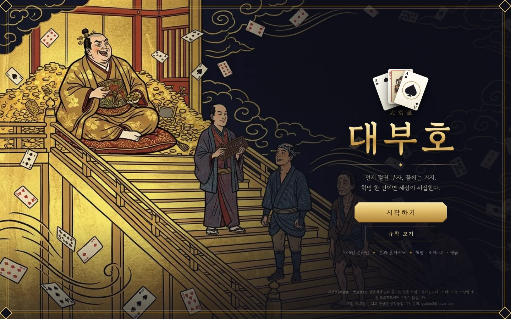
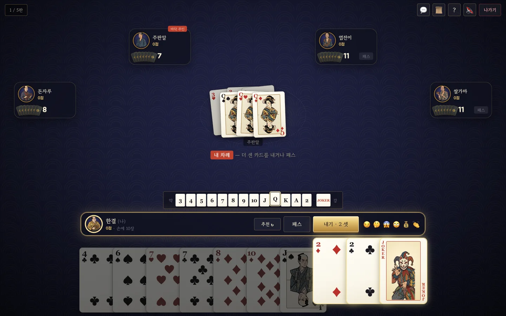
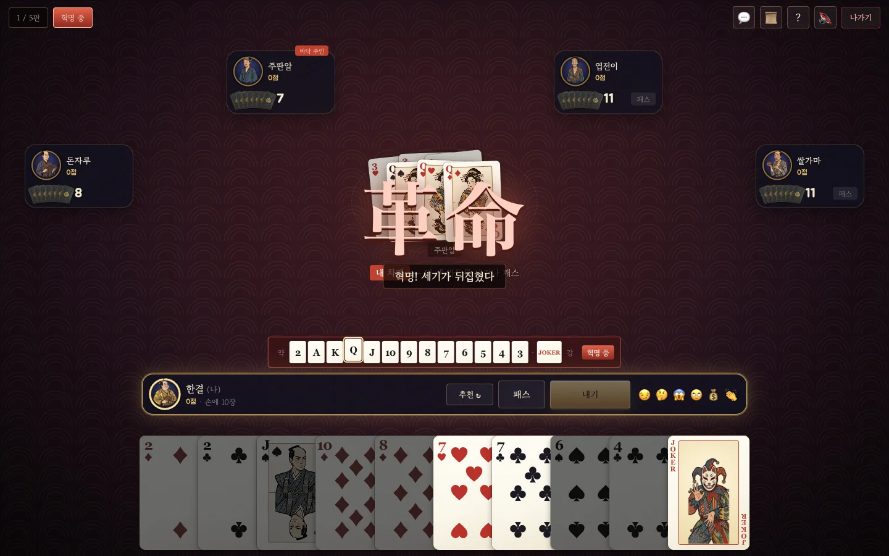
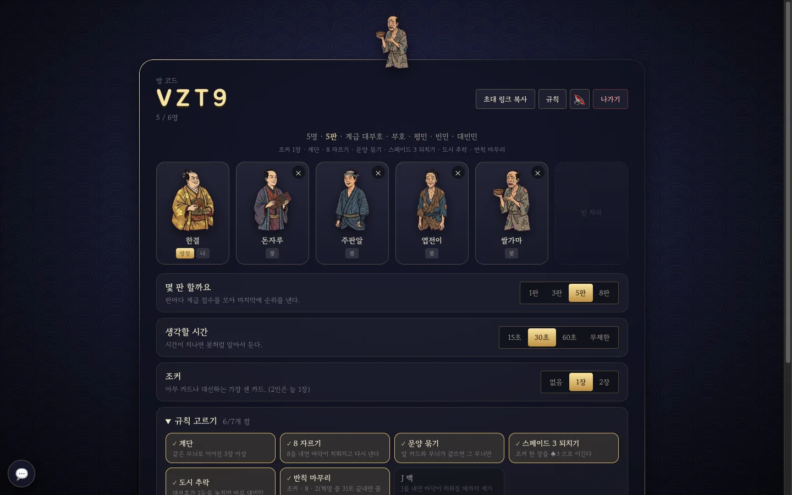
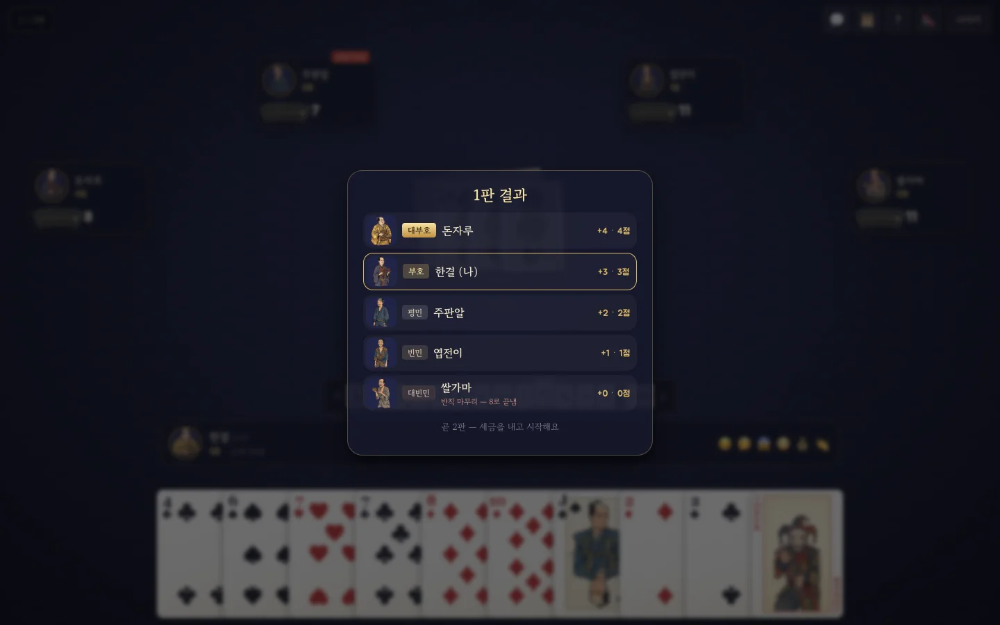
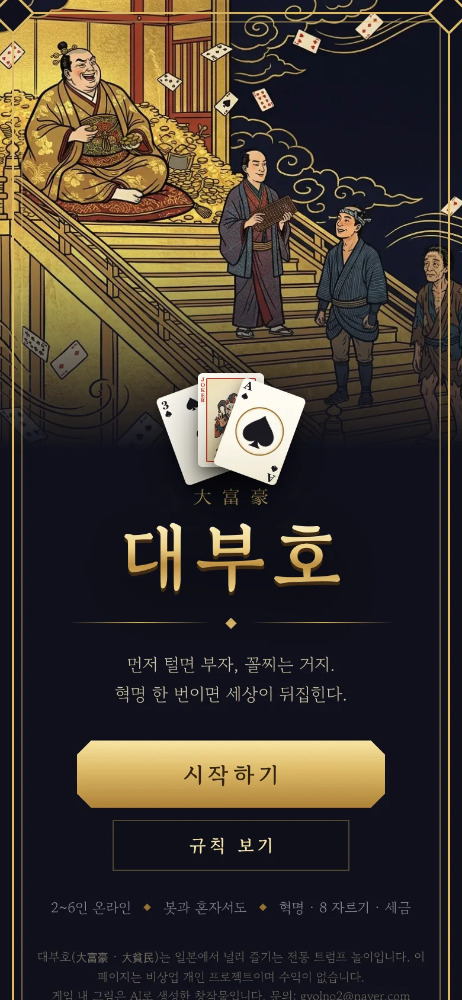
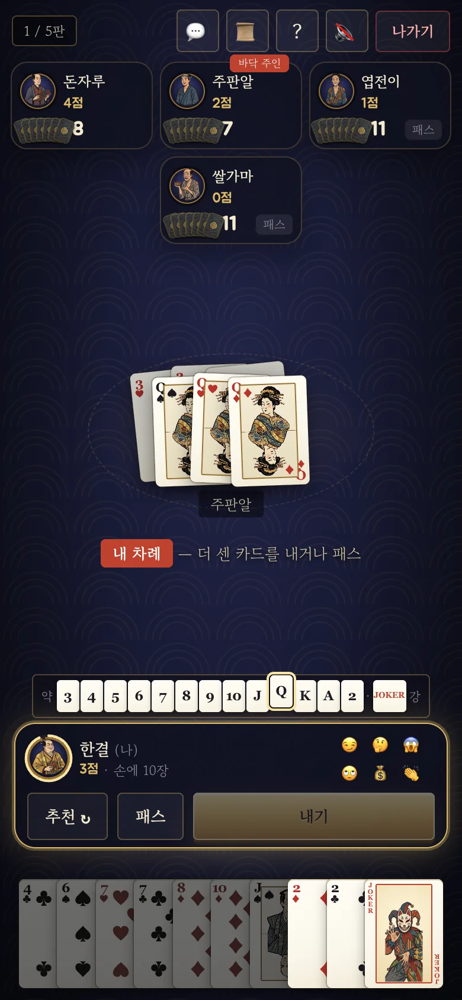

# 대부호 (大富豪)

일본 트럼프 놀이 **대부호**를 온라인으로. 가장 먼저 손을 털면 대부호, 꼴찌는 대빈민. 2~6인, 빈자리는 봇이 채운다.

플레이: https://daifugo.41ways.workers.dev



## 화면

| 판 | 혁명 |
|---|---|
|  |  |
| 바닥과 같은 꼴로 더 센 카드를 낸다. 아래 줄은 세기 순서(족보), 바닥에 나온 숫자에 금테 | 같은 숫자 4장이면 혁명. 세기 줄 · 손패 정렬이 뒤집힌다 |

| 대기실 | 판 결과 |
|---|---|
|  |  |
| 방장이 판 수 · 생각할 시간 · 조커 · 특수 규칙을 고른다 | 등수대로 계급과 점수. 반칙 마무리는 이유까지 |

<p align="center">
  
  &nbsp;
  
</p>

## 규칙

- 세기 3 < 4 < … < K < A < 2 < 조커. 한 장 · 같은 숫자 여러 장 · 계단(같은 무늬 3장 이상 연속)으로 낸다.
- 바닥과 같은 꼴 · 같은 장수로 더 센 카드를 내거나 패스. 모두 패스하면 마지막에 낸 사람이 새로 낸다.
- 다음 판은 세금부터 — 대빈민은 가장 센 2장을 대부호에게, 빈민은 1장을 부호에게. 받은 쪽은 아무 카드나 돌려준다.
- 일본 대부호 연맹 5대 공식 규칙(혁명 · 8 자르기 · 도시 추락 · 문양 묶기 · 스페이드 3 되치기)과 반칙 마무리, 계단이 기본. J 백은 고를 수 있다.
- 판마다 계급 점수(대부호 4 · 부호 3 · 평민 2 · 빈민 1 · 대빈민 0)를 모아 정한 판 수가 끝나면 순위.
- 2인은 3·4·5·J·Q·K·A·2 와 조커 1장(33장)으로 13장씩, 7장은 덮어 둔다 (나무위키 2인 규칙).

참고: [나무위키 대부호](https://namu.wiki/w/%EB%8C%80%EB%B6%80%ED%98%B8), [pagat.com Dai Hinmin](https://pagat.com/climbing/daifugo.html)

## 짜임

```
public/rules.js   카드 · 족보 · 내기 판정 · 봇 (서버와 화면이 같이 씀)
game.js           권위 서버 — 방 · 손패 · 바닥 · 혁명 · 세금 · 봇 · 열린 방 · 관전 · 채팅 · 재접속
worker.js         Cloudflare Worker + Durable Object 하나(main)
server.js         Node 로컬 서버 (8812)
public/           index.html · style.css · app.js · img/(제미나이 그림) · fonts/
tools/            그림 가공 (grab.sh · cut_sheet.py · build_court.py) · shots.js(README 화면 찍기)
test/             rules.js(판정) · sim.js(봇끼리 끝까지) · e2e.js(소켓)
```

## 시험 · 배포

```bash
npm test
DAIFUGO_FAST=1 PORT=8899 node server.js &  PORT=8899 node test/e2e.js
npx wrangler deploy
URL=wss://daifugo.41ways.workers.dev/ws ROUNDS=1 BOTS=0 node test/e2e.js
node tools/shots.js           # 로컬 서버를 띄운 채로 — docs/screens/ 다시 찍기
```

카드는 트럼프 그대로(모서리 숫자 · 무늬, 숫자 카드는 실제 무늬 배치)이고 J · Q · K · 조커와 계급 인물 · 카드 뒷면 · 타이틀만 제미나이로 그린 우키요에 그림이다.
비상업 개인 프로젝트.
